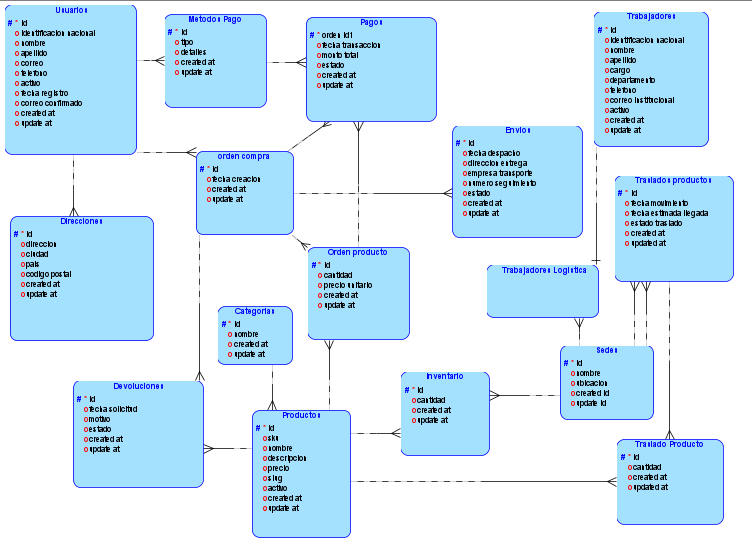
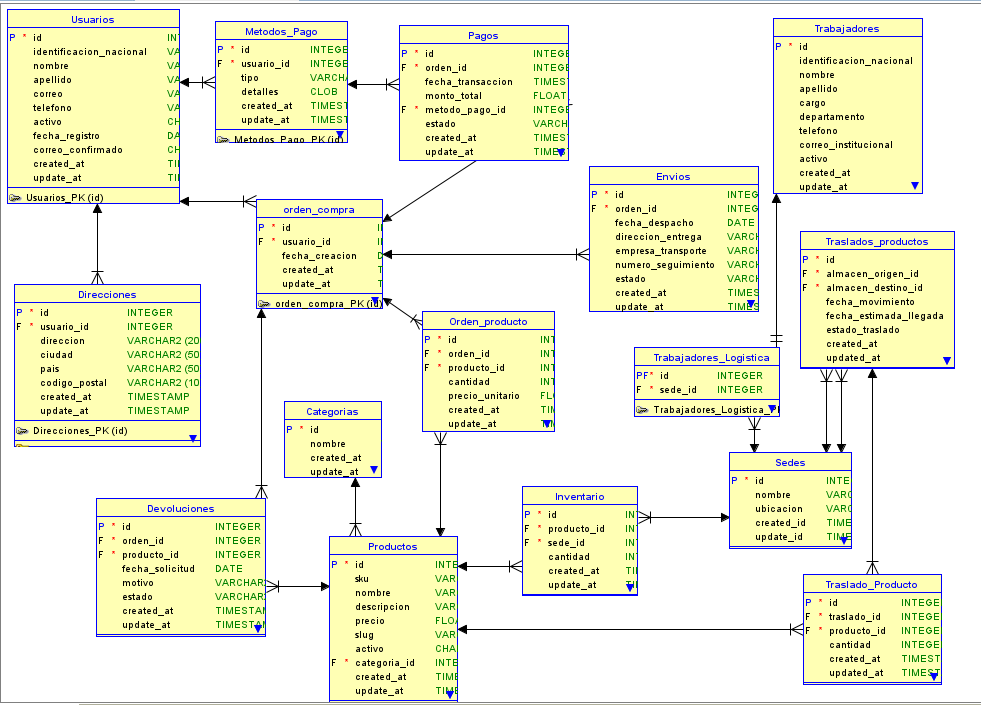

# Manual Tecnico

## Modelo Conceptual

Las 8 tablas principales del enunciado son:

1. **Usuarios**
2. **Trabajadores**
3. **Productos**
4. **Órdenes de compra**
5. **Pagos**
6. **Envíos**
7. **Devoluciones**
8. **Traslados de productos**

### 1. **Usuarios**

- `id` (PK, Identificador único)
- `identificacion_nacional`
- `nombre`
- `apellido`
- `correo`
- `telefono`
- `activo`
- `fecha_registro`
- `correo_confirmado`
- `direcciones`
- `metodos_pago`
- `created_at`
- `updated_at`

### 2. **Trabajadores**

- `id` (PK, Identificador único)
- `identificacion_nacional`
- `nombre`
- `apellido`
- `cargo`
- `departamento`
- `telefono`
- `correo_institucional`
- `sede_id`
- `activo`
- `created_at`
- `updated_at`

### 3. **Productos**

- `id` (PK, Identificador único)
- `sku`
- `nombre`
- `descripcion`
- `precio`
- `slug`
- `cantidad_inventario`
- `categoria_id`
- `activo`
- `imagenes`
- `created_at`
- `updated_at`

### 4. **Órdenes de Compra**

- `id` (PK, Identificador único)
- `fecha_creacion`
- `usuario_id`
- `productos`
- `created_at`
- `updated_at`

### 5. **Pagos**

- `id` (PK, Identificador único)
- `orden_id`
- `fecha_transaccion`
- `monto_total`
- `metodo_pago`
- `estado` (`pendiente`, `aprobado`, `rechazado`)
- `created_at`
- `updated_at`

### 6. **Envíos**

- `id` (PK, Identificador único)
- `fecha_despacho`
- `orden_id`
- `direccion_entrega`
- `empresa_transporte`
- `numero_seguimiento`
- `estado` (`en tránsito`, `entregado`, `devuelto`)
- `created_at`
- `updated_at`

### 7. **Devoluciones**

- `id` (PK, Identificador único)
- `orden_id`
- `fecha_solicitud`
- `motivo`
- `estado` (`en revisión`, `aprobada`, `rechazada`)
- `producto_id`
- `created_at`
- `updated_at`

### 8. **Traslados de Productos**

- `id` (PK, Identificador único)
- `fecha_movimiento`
- `almacen_origen_id`
- `almacen_destino_id`
- `producto_id`
- `cantidad_transferida`
- `estado_traslado`
- `fecha_estimada_llegada`
- `created_at`
- `updated_at`

## Modelo Logico 




## Modelo Fisico


## Fases del proceso de normalización, hasta forma normal 3

### **Fase 1: Primera Forma Normal (1FN)**

**Requisitos:**

- Los atributos deben ser atómicos (no valores repetidos o listas dentro de un mismo campo).
- Cada fila debe tener un identificador único (clave primaria).

### **Problemas detectados en el modelo inicial:**

- Los campos `productos` en **Órdenes de Compra** y **Traslados** contienen listas de productos, lo que viola la atomicidad.
- `direcciones` y `metodos_pago` en **Usuarios** también contienen listas de valores.

### **Solución:**

- Crear una tabla intermedia `Orden_Producto` para descomponer la relación de **Órdenes de Compra** con los productos comprados.
- Crear una tabla intermedia `Traslado_Producto` para separar la relación de traslados y productos transferidos.
- Crear tablas separadas `Direcciones` y `Metodos_Pago` y vincularlas con **Usuarios**.

---

### **Fase 2: Segunda Forma Normal (2FN)**

**Requisitos:**

- Debe estar en **1FN**.
- Todos los atributos no clave deben depender **completamente** de la clave primaria y no solo de una parte (evita dependencias parciales).

### **Problemas detectados en el modelo:**

- En `Orden_Producto`, los atributos `precio_unitario` y `cantidad` dependen de la combinación (`orden_id`, `producto_id`), lo cual es correcto.
- En `Trabajadores`, `sede_id` solo aplica a ciertos trabajadores (los de logística), por lo que puede dividirse en una entidad separada para evitar datos nulos innecesarios.
- En `Productos`, `categoria_id` es una dependencia lógica que debe ir en una tabla `Categorias`.

### **Solución:**

- Separar la tabla **Trabajadores** en `Trabajadores` (datos generales) y `Trabajadores_Logistica` (para los que tienen una sede asignada).
- Crear una tabla **Categorias** con `id` y `nombre`, referenciada en **Productos**.

---

### **Fase 3: Tercera Forma Normal (3FN)**

**Requisitos:**

- Debe estar en **2FN**.
- No debe haber **dependencias transitivas** (atributos que dependen de otros atributos no clave en lugar de la clave primaria).

### **Problemas detectados en el modelo:**

- En **Usuarios**, la **identificación nacional** puede depender de otra entidad (puede ser una clave externa si se valida en otra tabla).
- En **Pagos**, el método de pago puede tener más detalles (como nombre, comisión, etc.), por lo que debe separarse en una tabla **Metodos_Pago**.

### **Solución:**

- Extraer `Metodo_Pago` en una tabla separada con detalles adicionales.
- Si hay una fuente externa para `identificacion_nacional`, se puede referenciar en una tabla externa.

---

### **Modelo Normalizado hasta 3FN**

Lista final de tablas normalizadas:

### **Usuarios**

- `id` (PK)
- `identificacion_nacional`
- `nombre`
- `apellido`
- `correo`
- `telefono`
- `activo`
- `fecha_registro`
- `correo_confirmado`
- `created_at`
- `updated_at`

Aquí tienes una tabla de ejemplo utilizando los campos de Usuarios:

| **id** | **identificacion_nacional** | **nombre** | **apellido** | **correo** | **telefono** | **activo** | **fecha_registro** | **correo_confirmado** | **created_at** | **updated_at** |
| --- | --- | --- | --- | --- | --- | --- | --- | --- | --- | --- |
| 1 | 123456789 | Juan | Pérez | juan.perez@ejemplo.com | 555-123-4567 | true | 2024-01-15 | true | 2024-01-15 10:30:00 | 2024-02-20 14:45:22 |
| 2 | 987654321 | María | García | maria.garcia@ejemplo.com | 555-987-6543 | true | 2024-02-05 | true | 2024-02-05 09:15:30 | 2024-02-05 09:15:30 |
| 3 | 456789123 | Carlos | Rodríguez | carlos.rodriguez@ejemplo.com | 555-456-7890 | false | 2023-11-20 | true | 2023-11-20 16:20:45 | 2025-01-10 11:30:15 |

### **Direcciones**

- `id` (PK)
- `usuario_id` (FK)
- `direccion`
- `ciudad`
- `pais`
- `codigo_postal`
- `created_at`
- `updated_at`

| **id** | **usuario_id** | **direccion** | **ciudad** | **pais** | **codigo_postal** | **created_at** | **updated_at** |
| --- | --- | --- | --- | --- | --- | --- | --- |
| 1 | 1 | Calle Principal 123 | Madrid | España | 28001 | 2024-01-15 10:35:22 | 2024-01-15 10:35:22 |
| 2 | 1 | Avenida Secundaria 456 | Barcelona | España | 08001 | 2024-01-20 14:22:45 | 2024-02-05 09:10:30 |
| 3 | 2 | Plaza Central 789 | Valencia | España | 46001 | 2024-02-06 11:45:18 | 2024-02-06 11:45:18 |

### **Métodos de Pago**

- `id` (PK)
- `usuario_id` (FK)
- `tipo` (tarjeta, transferencia, etc.)
- `detalles` (número de tarjeta encriptado, etc.)
- `created_at`
- `updated_at`

| **id** | **usuario_id** | **tipo** | **detalles** | **created_at** | **updated_at** |
| --- | --- | --- | --- | --- | --- |
| 1 | 1 | tarjeta | **** **** **** 4321 | 2024-01-15 10:40:15 | 2024-01-15 10:40:15 |
| 2 | 1 | transferencia | ES12 3456 7890 1234 5678 | 2024-02-10 09:25:30 | 2024-02-10 09:25:30 |
| 3 | 2 | tarjeta | **** **** **** 9876 | 2024-02-06 12:15:45 | 2024-02-06 12:15:45 |

### **Trabajadores**

- `id` (PK)
- `identificacion_nacional`
- `nombre`
- `apellido`
- `cargo`
- `departamento`
- `telefono`
- `correo_institucional`
- `activo`
- `created_at`
- `updated_at`

| **id** | **identificacion_nacional** | **nombre** | **apellido** | **cargo** | **departamento** | **telefono** | **correo_institucional** | **activo** | **created_at** | **updated_at** |
| --- | --- | --- | --- | --- | --- | --- | --- | --- | --- | --- |
| 1 | 12345678A | Ana | Martínez | Jefe de Almacén | Logística | 555-111-2222 | ana.martinez@empresa.com | true | 2023-10-15 08:30:00 | 2024-01-10 14:20:15 |
| 2 | 87654321B | Roberto | Sánchez | Auxiliar | Atención al Cliente | 555-333-4444 | roberto.sanchez@empresa.com | true | 2023-11-05 09:15:30 | 2023-11-05 09:15:30 |
| 3 | 45678912C | Carmen | López | Especialista | Logística | 555-555-6666 | carmen.lopez@empresa.com | false | 2022-06-20 10:45:00 | 2024-02-15 11:30:45 |

### **Trabajadores Logística**

- `id` (PK, FK de Trabajadores)
- `sede_id` (FK, referencia a sedes)

| **id** | **sede_id** |
| --- | --- |
| 1 | 3 |
| 3 | 1 |

### **Sedes/Centros de Distribución**

- `id` (PK)
- `nombre`
- `ubicacion`
- `created_at`
- `updated_at`

| **id** | **nombre** | **ubicacion** | **created_at** | **updated_at** |
| --- | --- | --- | --- | --- |
| 1 | Centro Madrid | Calle Industrial 123, Madrid | 2023-08-15 09:00:00 | 2024-01-20 14:30:45 |
| 2 | Almacén Barcelona | Polígono Industrial Este, Barcelona | 2023-09-10 10:15:30 | 2023-09-10 10:15:30 |
| 3 | Sede Central Valencia | Avenida del Puerto 45, Valencia | 2022-11-05 08:45:20 | 2024-02-15 11:20:00 |

### **Productos**

- `id` (PK)
- `sku`
- `nombre`
- `descripcion`
- `precio`
- `slug`
- `activo`
- `categoria_id` (FK)
- `created_at`
- `updated_at`

| **id** | **sku** | **nombre** | **descripcion** | **precio** | **slug** | **activo** | **categoria_id** | **created_at** | **updated_at** |
| --- | --- | --- | --- | --- | --- | --- | --- | --- | --- |
| 1 | P001 | Laptop Pro | Laptop de última generación | 1200.00 | laptop-pro | true | 2 | 2023-12-10 10:25:30 | 2024-01-15 14:30:45 |
| 2 | P002 | Smartphone X | Teléfono inteligente con cámara avanzada | 699.99 | smartphone-x | true | 1 | 2024-01-05 08:45:20 | 2024-01-05 08:45:20 |
| 3 | P003 | Auriculares Wireless | Auriculares bluetooth con cancelación de ruido | 129.95 | auriculares-wireless | true | 3 | 2023-11-20 15:10:05 | 2024-02-01 09:20:15 |

### **Categorías**

- `id` (PK)
- `nombre`
- `created_at`
- `updated_at`

| **id** | **nombre** | **created_at** | **updated_at** |
| --- | --- | --- | --- |
| 1 | Teléfonos | 2023-10-05 08:30:00 | 2023-10-05 08:30:00 |
| 2 | Computadoras | 2023-10-05 08:35:15 | 2024-01-10 11:20:45 |
| 3 | Accesorios | 2023-10-05 08:40:30 | 2023-12-20 14:15:00 |

### **Inventario**

- `id` (PK)
- `producto_id` (FK)
- `sede_id` (FK)
- `cantidad`
- `created_at`
- `updated_at`

| **id** | **producto_id** | **sede_id** | **cantidad** | **created_at** | **updated_at** |
| --- | --- | --- | --- | --- | --- |
| 1 | 1 | 3 | 25 | 2024-01-10 09:25:30 | 2024-02-15 14:30:45 |
| 2 | 2 | 1 | 15 | 2024-01-15 08:45:20 | 2024-01-15 08:45:20 |
| 3 | 3 | 2 | 50 | 2023-12-20 15:10:05 | 2024-01-30 09:20:15 |
| 4 | 1 | 1 | 10 | 2024-01-05 11:35:40 | 2024-02-10 10:15:30 |
| 5 | 2 | 3 | 30 | 2024-01-20 14:20:55 | 2024-01-20 14:20:55 |

### **Órdenes de Compra**

- `id` (PK)
- `usuario_id` (FK)
- `fecha_creacion`
- `created_at`
- `updated_at`

| **id** | **usuario_id** | **fecha_creacion** | **created_at** | **updated_at** |
| --- | --- | --- | --- | --- |
| 1 | 101 | 2024-02-10 14:30:00 | 2024-02-10 14:30:00 | 2024-02-10 14:30:00 |
| 2 | 102 | 2024-02-15 09:45:20 | 2024-02-15 09:45:20 | 2024-02-15 09:45:20 |
| 3 | 101 | 2024-02-20 16:25:10 | 2024-02-20 16:25:10 | 2024-02-22 10:15:30 |

### **Orden_Producto**

- `id` (PK)
- `orden_id` (FK)
- `producto_id` (FK)
- `cantidad`
- `precio_unitario`
- `created_at`
- `updated_at`

| **id** | **orden_id** | **producto_id** | **cantidad** | **precio_unitario** | **created_at** | **updated_at** |
| --- | --- | --- | --- | --- | --- | --- |
| 1 | 1 | 1 | 2 | 1200.00 | 2024-02-10 14:30:00 | 2024-02-10 14:30:00 |
| 2 | 1 | 3 | 1 | 129.95 | 2024-02-10 14:30:00 | 2024-02-10 14:30:00 |
| 3 | 2 | 2 | 1 | 699.99 | 2024-02-15 09:45:20 | 2024-02-15 09:45:20 |
| 4 | 3 | 1 | 1 | 1200.00 | 2024-02-20 16:25:10 | 2024-02-20 16:25:10 |
| 5 | 3 | 2 | 3 | 699.99 | 2024-02-20 16:25:10 | 2024-02-20 16:25:10 |

### **Pagos**

- `id` (PK)
- `orden_id` (FK)
- `fecha_transaccion`
- `monto_total`
- `metodo_pago_id` (FK)
- `estado`
- `created_at`
- `updated_at`

| **id** | **orden_id** | **fecha_transaccion** | **monto_total** | **metodo_pago_id** | **estado** | **created_at** | **updated_at** |
| --- | --- | --- | --- | --- | --- | --- | --- |
| 1 | 1 | 2024-02-10 15:45:20 | 2529.95 | 2 | completado | 2024-02-10 15:45:20 | 2024-02-10 15:45:20 |
| 2 | 2 | 2024-02-15 10:30:45 | 699.99 | 1 | completado | 2024-02-15 10:30:45 | 2024-02-15 10:30:45 |
| 3 | 3 | 2024-02-20 16:55:10 | 3299.97 | 3 | pendiente | 2024-02-20 16:55:10 | 2024-02-22 11:20:30 |

### **Envíos**

- `id` (PK)
- `orden_id` (FK)
- `fecha_despacho`
- `direccion_entrega`
- `empresa_transporte`
- `numero_seguimiento`
- `estado`
- `created_at`
- `updated_at`

| **id** | **orden_id** | **fecha_despacho** | **direccion_entrega** | **empresa_transporte** | **numero_seguimiento** | **estado** | **created_at** | **updated_at** |
| --- | --- | --- | --- | --- | --- | --- | --- | --- |
| 1 | 1 | 2024-02-12 10:30:00 | Calle Principal 123, Ciudad | Express Delivery | ED12345678 | entregado | 2024-02-11 15:45:20 | 2024-02-13 09:20:15 |
| 2 | 2 | 2024-02-17 09:15:30 | Av. Central 456, Ciudad | Fast Shipping | FS87654321 | en tránsito | 2024-02-16 11:30:45 | 2024-02-17 14:25:10 |
| 3 | 3 | 2024-02-22 14:45:00 | Plaza Mayor 789, Ciudad | Express Delivery | ED98765432 | preparando | 2024-02-21 16:55:10 | 2024-02-22 10:15:30 |

### **Devoluciones**

- `id` (PK)
- `orden_id` (FK)
- `producto_id` (FK)
- `fecha_solicitud`
- `motivo`
- `estado`
- `created_at`
- `updated_at`

| **id** | **orden_id** | **producto_id** | **fecha_solicitud** | **motivo** | **estado** | **created_at** | **updated_at** |
| --- | --- | --- | --- | --- | --- | --- | --- |
| 1 | 1 | 3 | 2024-02-15 09:30:00 | producto defectuoso | aprobada | 2024-02-15 09:30:00 | 2024-02-16 14:20:15 |
| 2 | 2 | 2 | 2024-02-18 11:45:20 | producto incorrecto | pendiente | 2024-02-18 11:45:20 | 2024-02-18 11:45:20 |
| 3 | 1 | 1 | 2024-02-20 16:25:10 | cambio de opinión | rechazada | 2024-02-20 16:25:10 | 2024-02-21 10:15:30 |

### **Traslados de Productos**

- `id` (PK)
- `almacen_origen_id` (FK)
- `almacen_destino_id` (FK)
- `fecha_movimiento`
- `fecha_estimada_llegada`
- `estado_traslado`
- `created_at`
- `updated_at`

| **id** | **almacen_origen_id** | **almacen_destino_id** | **fecha_movimiento** | **fecha_estimada_llegada** | **estado_traslado** | **created_at** | **updated_at** |
| --- | --- | --- | --- | --- | --- | --- | --- |
| 1 | 2 | 1 | 2024-02-14 08:30:00 | 2024-02-15 16:00:00 | completado | 2024-02-14 08:30:00 | 2024-02-15 17:15:20 |
| 2 | 1 | 3 | 2024-02-18 10:45:30 | 2024-02-19 14:00:00 | en tránsito | 2024-02-18 10:45:30 | 2024-02-18 16:20:45 |
| 3 | 3 | 2 | 2024-02-22 13:15:00 | 2024-02-23 17:30:00 | pendiente | 2024-02-22 13:15:00 | 2024-02-22 13:15:00 |

### **Traslado_Producto**

- `id` (PK)
- `traslado_id` (FK)
- `producto_id` (FK)
- `cantidad`
- `created_at`
- `updated_at`

| **id** | **traslado_id** | **producto_id** | **cantidad** | **created_at** | **updated_at** |
| --- | --- | --- | --- | --- | --- |
| 1 | 1 | 2 | 15 | 2024-02-14 08:30:00 | 2024-02-14 08:30:00 |
| 2 | 1 | 5 | 10 | 2024-02-14 08:30:00 | 2024-02-14 08:30:00 |
| 3 | 2 | 1 | 20 | 2024-02-18 10:45:30 | 2024-02-18 10:45:30 |
| 4 | 2 | 3 | 8 | 2024-02-18 10:45:30 | 2024-02-18 10:45:30 |
| 5 | 3 | 4 | 12 | 2024-02-22 13:15:00 | 2024-02-22 13:15:00 |

## Descripción de las Tablas
 Descripción de las Tablas

**Usuarios**
- Almacena la información de los clientes de la plataforma, incluyendo nombre, apellido, correo, teléfono y estado de actividad.

**Direcciones**
- Contiene las direcciones de los usuarios, incluyendo ciudad, país y código postal. Cada dirección está asociada a un usuario.

**Metodos_Pago**
- Guarda los métodos de pago registrados por los usuarios, como tarjetas de crédito o débito.

**Pagos**
- Registra las transacciones realizadas por los usuarios, incluyendo el monto, fecha y estado del pago (pendiente, aprobado, rechazado).

**Trabajadores**
- Almacena los datos de los empleados de la empresa, como nombre, cargo, departamento y contacto institucional.

**Sedes**
- Contiene información sobre las distintas sedes o almacenes de la empresa, con su nombre y ubicación.

**Trabajadores_Logistica**
- Asocia a los trabajadores con la sede donde realizan sus labores logísticas.

**Categorias**
- Clasifica los productos de la tienda en diferentes categorías, facilitando su organización y búsqueda.

**Productos**
- Almacena información sobre los productos disponibles, como nombre, descripción, precio, SKU y categoría a la que pertenecen.

**Inventario**
- Registra la cantidad de productos disponibles en cada sede o almacén.

**Orden_Compra**
- Representa los pedidos realizados por los clientes, incluyendo la fecha y el usuario que los creó.

**Orden_Productos**
- Relaciona los productos con una orden de compra, especificando la cantidad comprada y el precio unitario.

**Envios**
- Contiene información sobre los envíos de los pedidos, incluyendo la dirección de entrega, la empresa de transporte y el número de seguimiento.

**Devoluciones**
- Registra las solicitudes de devolución de productos, con el motivo y el estado de la revisión (en proceso, aprobada o rechazada).

**Traslados_Productos** 
- Almacena el movimiento de productos entre diferentes almacenes o sedes, con fechas y estado del traslado.

**Traslado_Producto**
- Especifica los productos incluidos en cada traslado, con la cantidad de cada uno.

|                 | Usuarios | Trabajadores | Trabajadores Logística | Sedes | Categorías | Productos | Inventario | Órdenes de Compra | Orden_Producto | Pagos | Métodos de Pago | Envíos | Devoluciones | Traslados de Productos | Traslado_Producto | Direcciones |
|----------------|----------|-------------|--------------------|-------|------------|----------|-----------|-----------------|---------------|-------|---------------|--------|-------------|------------------|----------------|-------------|
| **Usuarios**  | -        | -           | -                  | -     | -          | -        | -         | 1 a M           | -             | -     | 1 a M         | -      | -           | -                | -              | 1 a M       |
| **Trabajadores** | -        | -           | 1 a 1              | -     | -          | -        | -         | -               | -             | -     | -             | -      | -           | -                | -              | -           |
| **Trabajadores Logística** | -        | 1 a 1       | -                  | 1 a M | -          | -        | -         | -               | -             | -     | -             | -      | -           | -                | -              | -           |
| **Sedes**      | -        | -           | 1 a M              | -     | -          | -        | 1 a M     | -               | -             | -     | -             | -      | -           | 1 a M            | -              | -           |
| **Categorías** | -        | -           | -                  | -     | -          | 1 a M    | -         | -               | -             | -     | -             | -      | -           | -                | -              | -           |
| **Productos**  | -        | -           | -                  | -     | 1 a M      | -        | 1 a M     | -               | 1 a M         | -     | -             | -      | 1 a M       | -                | 1 a M          | -           |
| **Inventario** | -        | -           | -                  | 1 a M | -          | 1 a M    | -         | -               | -             | -     | -             | -      | -           | -                | -              | -           |
| **Órdenes de Compra** | 1 a M    | -           | -                  | -     | -          | -        | -         | -               | 1 a M         | 1 a 1 | -             | 1 a 1  | 1 a M       | -                | -              | -           |
| **Orden_Producto** | -        | -           | -                  | -     | -          | 1 a M    | -         | 1 a M           | -             | -     | -             | -      | -           | -                | -              | -           |
| **Pagos**      | -        | -           | -                  | -     | -          | -        | -         | 1 a 1           | -             | -     | 1 a M         | -      | -           | -                | -              | -           |
| **Métodos de Pago** | 1 a M    | -           | -                  | -     | -          | -        | -         | -               | -             | 1 a M | -             | -      | -           | -                | -              | -           |
| **Envíos**     | -        | -           | -                  | -     | -          | -        | -         | 1 a 1           | -             | -     | -             | -      | -           | -                | -              | -           |
| **Devoluciones** | -        | -           | -                  | -     | -          | 1 a M    | -         | 1 a M           | -             | -     | -             | -      | -           | -                | -              | -           |
| **Traslados de Productos** | -        | -           | -                  | 1 a M | -          | -        | -         | -               | -             | -     | -             | -      | -           | -                | 1 a M          | -           |
| **Traslado_Producto** | -        | -           | -                  | -     | -          | 1 a M    | -         | -               | -             | -     | -             | -      | -           | 1 a M            | -              | -           |
| **Direcciones** | 1 a M    | -           | -                  | -     | -          | -        | -         | -               | -             | -     | -             | -      | -           | -                | -              | -           |

---

## Descripción de la API

Esta API proporciona un conjunto de endpoints para la gestión de productos y usuarios en una base de datos Oracle utilizando Sequelize. Permite realizar operaciones CRUD (Crear, Leer, Actualizar, Eliminar) sobre los recursos disponibles.

## Descripción de los Endpoints utilizados

### **Endpoints de Usuarios**
1. **Obtener todos los usuarios**  
   - **Método:** `GET`  
   - **Endpoint:** `/api/users`  
   - **Descripción:** Obtiene la lista de todos los usuarios registrados.  
   - **Ejemplo de respuesta:**
     ```json
     [
       {
         "id": 1,
         "identificacion_nacional": "123456789",
         "nombre": "Juan",
         "apellido": "Perez",
         "correo": "juan@example.com",
         "telefono": "12345678",
         "activo": 1
       }
     ]
     ```

2. **Obtener un usuario por ID**  
   - **Método:** `GET`  
   - **Endpoint:** `/api/users/:id`  
   - **Descripción:** Obtiene la información de un usuario específico mediante su ID.  
   - **Ejemplo de respuesta:**
     ```json
     {
       "id": 1,
       "identificacion_nacional": "123456789",
       "nombre": "Juan",
       "apellido": "Perez",
       "correo": "juan@example.com",
       "telefono": "12345678",
       "activo": 1
     }
     ```

3. **Crear un nuevo usuario**  
   - **Método:** `POST`  
   - **Endpoint:** `/api/users`  
   - **Descripción:** Crea un nuevo usuario con los datos proporcionados.  
   - **Ejemplo de cuerpo de solicitud:**
     ```json
     {
       "identificacion_nacional": "987654321",
       "nombre": "Maria",
       "apellido": "Lopez",
       "correo": "maria@example.com",
       "telefono": "87654321"
     }
     ```
   - **Ejemplo de respuesta:**
     ```json
     {
       "message": "Usuario creado exitosamente",
       "user": {
         "id": 2,
         "identificacion_nacional": "987654321",
         "nombre": "Maria",
         "apellido": "Lopez",
         "correo": "maria@example.com",
         "telefono": "87654321",
         "activo": 1
       }
     }
     ```

4. **Actualizar un usuario**  
   - **Método:** `PUT`  
   - **Endpoint:** `/api/users/:id`  
   - **Descripción:** Modifica los datos de un usuario específico.  
   - **Ejemplo de cuerpo de solicitud:**
     ```json
     {
       "nombre": "Maria Fernanda",
       "telefono": "12312312"
     }
     ```
   - **Ejemplo de respuesta:**
     ```json
     {
       "message": "Usuario actualizado exitosamente"
     }
     ```

5. **Eliminar un usuario**  
   - **Método:** `DELETE`  
   - **Endpoint:** `/api/users/:id`  
   - **Descripción:** Elimina un usuario por su ID.  
   - **Ejemplo de respuesta:**
     ```json
     {
       "message": "Usuario eliminado exitosamente"
     }
     ```

---

### **Endpoints de Productos**
1. **Obtener todos los productos**  
   - **Método:** `GET`  
   - **Endpoint:** `/api/products`  
   - **Descripción:** Obtiene la lista de todos los productos disponibles.  
   - **Ejemplo de respuesta:**
     ```json
     [
       {
         "id": 1,
         "sku": "PROD001",
         "nombre": "Laptop HP",
         "descripcion": "Laptop de alto rendimiento",
         "precio": 1200.99,
         "slug": "laptop-hp",
         "categoria_id": 2,
         "activo": 1
       }
     ]
     ```

2. **Obtener un producto por ID**  
   - **Método:** `GET`  
   - **Endpoint:** `/api/products/:id`  
   - **Descripción:** Obtiene la información de un producto específico mediante su ID.  
   - **Ejemplo de respuesta:**
     ```json
     {
       "id": 1,
       "sku": "PROD001",
       "nombre": "Laptop HP",
       "descripcion": "Laptop de alto rendimiento",
       "precio": 1200.99,
       "slug": "laptop-hp",
       "categoria_id": 2,
       "activo": 1
     }
     ```

3. **Crear un nuevo producto**  
   - **Método:** `POST`  
   - **Endpoint:** `/api/products`  
   - **Descripción:** Crea un nuevo producto con los datos proporcionados.  
   - **Ejemplo de cuerpo de solicitud:**
     ```json
     {
       "sku": "PROD002",
       "nombre": "Mouse Logitech",
       "descripcion": "Mouse inalámbrico",
       "precio": 29.99,
       "slug": "mouse-logitech",
       "categoria_id": 1
     }
     ```
   - **Ejemplo de respuesta:**
     ```json
     {
       "message": "Producto creado exitosamente",
       "product": {
         "id": 2,
         "sku": "PROD002",
         "nombre": "Mouse Logitech",
         "descripcion": "Mouse inalámbrico",
         "precio": 29.99,
         "slug": "mouse-logitech",
         "categoria_id": 1,
         "activo": 1
       }
     }
     ```

4. **Actualizar un producto**  
   - **Método:** `PUT`  
   - **Endpoint:** `/api/products/:id`  
   - **Descripción:** Modifica los datos de un producto específico.  
   - **Ejemplo de cuerpo de solicitud:**
     ```json
     {
       "precio": 25.99,
       "descripcion": "Mouse inalámbrico con mejor batería"
     }
     ```
   - **Ejemplo de respuesta:**
     ```json
     {
       "message": "Producto actualizado exitosamente"
     }
     ```

5. **Eliminar un producto**  
   - **Método:** `DELETE`  
   - **Endpoint:** `/api/products/:id`  
   - **Descripción:** Elimina un producto por su ID.  
   - **Ejemplo de respuesta:**
     ```json
     {
       "message": "Producto eliminado exitosamente"
     }
     ```

